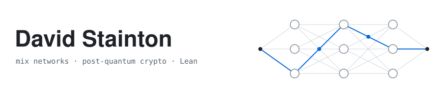

  <picture>
    <source media="(prefers-color-scheme: dark)" srcset="header-dark.svg">
    <source media="(prefers-color-scheme: light)" srcset="header-light.svg">
    
  </picture>

  <samp>
    <a href="https://sphinx.rs">My website</a> ·
    <a href="https://sphinx.rs/blog/">My blog (older posts)</a> ·
    <a href="https://katzenpost.network">katzenpost.network</a> ·
    <a href="https://arxiv.org/abs/2501.02933">Echomix paper</a> ·
    <a href="https://status.namenlos.network/">namenlos mixnet status</a> ·
    <a href="https://katzenpost.network/pages/moral-character/">Moral character</a> ·
    <a href="https://katzenpost.network/pages/chat-control/">Chat Control</a>
  </samp>

I'm David Stainton. I work on free software, mix networks and post-quantum cryptography.

I founded and lead [Katzenpost](https://github.com/katzenpost/katzenpost), a free software, post-quantum mix network that protects metadata against a global passive adversary. With my coauthors I described its design in **[Echomix: a Strong Anonymity System with Messaging](https://arxiv.org/abs/2501.02933)** (Ewa, David, Leif and Threebit&nbsp;Hacker, 2025). For what it's worth, in the before times I wrote code by hand in Lean, Rust, Golang, Nim, Python after abandoning C, C++ and Perl many years ago. These days I'm getting more into formal methods.

💼 **Available for consulting and contract work:** mix networks, post-quantum cryptography, protocol design and formal verification in Lean. Get in touch via [my website](https://sphinx.rs/contact/).

Since 2019, when its EU research grant ended, Katzenpost has run on volunteers and small foundation grants. If you value this work, sponsoring me keeps it going.

**[Sponsor me on GitHub](https://github.com/sponsors/david415)**

### Currently

- **Pigeonhole on Reticulum**: storage replicas for Reticulum meshes, in Rust (Reticulum-rs) and Python ([pigeonhole_rns](https://github.com/katzenpost/pigeonhole_rns)), that bridge the mesh to the mixnet; on the mesh, the group chat client [katzenrns](https://github.com/katzenpost/katzenrns) shares groups with mixnet clients.
- **[pigeonhole_reticulous](https://github.com/katzenpost/pigeonhole_reticulous)**: Pigeonhole apps, starting with group chat, for Reticulous devices such as the LilyGO T-Deck Plus, which share groups with mixnet clients through a bridge replica.
- **[hushphone](https://github.com/katzenpost/hushphone)**: group chat and push-to-talk voice for Linux and Android, in Rust and Slint, over the mixnet or a Reticulum mesh.
- **[pigeonhole_protocols](https://github.com/katzenpost/pigeonhole_protocols)**: group chat and mixnet services over Pigeonhole, in Go, Rust and Python, each protocol written as a sans-IO state machine.
- **[hpqc](https://github.com/katzenpost/hpqc)**: the hybrid post-quantum NIKEs, KEMs and signatures that Katzenpost uses, in Go, Python and Rust.
- **[Cryptlib](https://cryptlib.io/)** ([GitHub](https://github.com/katzenpost/cryptlib)): a Lean library whose primitives are types that carry their own proof obligations; it began as a model of hpqc and now also implements protocols beyond it, such as Katzenpost's Sphinx packet format, checked against Katzenpost's test vectors.
- **[Formalizing Sphinx in Lean](https://katzenpost.network/blog/2026/10/31/formalizing-sphinx-in-lean/)**: how Cryptlib's Sphinx is written generically over its primitives and proved correct for any choice of them.
- **High assurance in Lean 4**: Noise and PQ Noise ([uproar](https://github.com/katzenpost/uproar)), the TLS 1.3 handshake as QUIC carries it ([lean_tls](https://github.com/katzenpost/lean_tls)) and post-quantum QUIC ([lean_quic](https://github.com/katzenpost/lean_quic)), all built on Cryptlib.

<table><tr><td valign="top" width="50%">

### Recent releases
<!-- releases starts -->
- [kpclientd-android v1.1.0](https://github.com/katzenpost/kpclientd-android/releases/tag/v1.1.0) - 2026-10-30
- [hushphone v0.1.3](https://github.com/katzenpost/hushphone/releases/tag/v0.1.3) - 2026-10-29
- [hushphone v0.1.2](https://github.com/katzenpost/hushphone/releases/tag/v0.1.2) - 2026-10-29
- [hushphone v0.1.1](https://github.com/katzenpost/hushphone/releases/tag/v0.1.1) - 2026-10-28
- [frank_chat v0.4.1](https://github.com/katzenpost/frank_chat/releases/tag/v0.4.1) - 2026-10-27
<!-- releases ends -->

</td><td valign="top" width="50%">

### Katzenpost Blog posts
<!-- blog starts -->
- [Formalizing Sphinx in Lean](https://katzenpost.network/blog/2026/10/31/formalizing-sphinx-in-lean/) - 2026-10-31
- [Katzenpost threat model document](https://katzenpost.network/blog/2024/04/25/katzenpost-threat-model-document/) - 2024-04-25
- [Mixnet Literature Overview](https://katzenpost.network/blog/2024/04/15/mixnet-literature-overview/) - 2024-04-15
- [hpqc - hybrid post quantum cryptography library](https://katzenpost.network/blog/2024/04/12/hpqc-hybrid-post-quantum-cryptography-library/) - 2024-04-12
- [Katzenpost at 37C3](https://katzenpost.network/blog/2024/01/28/katzenpost-at-37c3/) - 2024-01-28
<!-- blog ends -->

</td></tr></table>
